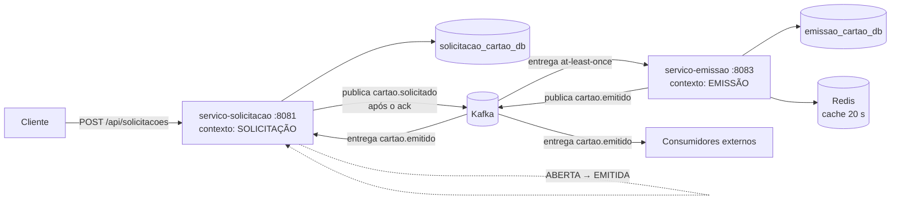
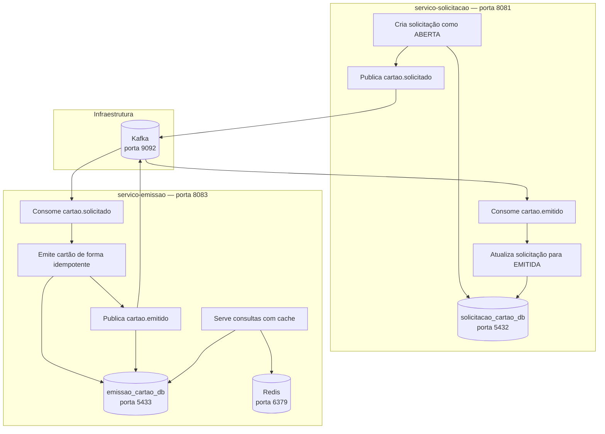
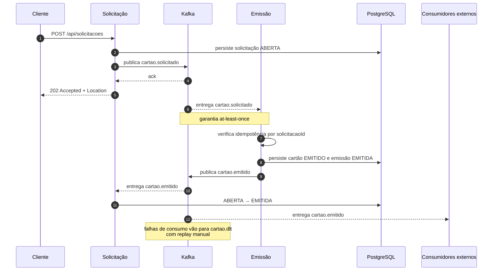
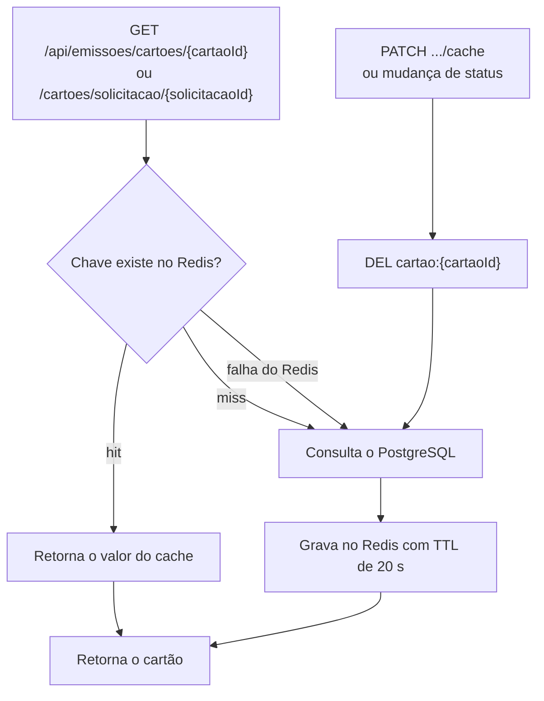
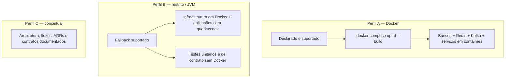
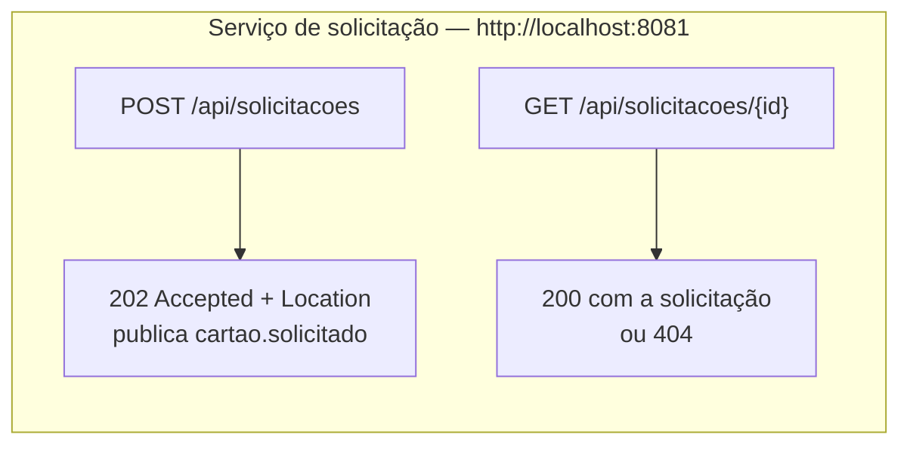
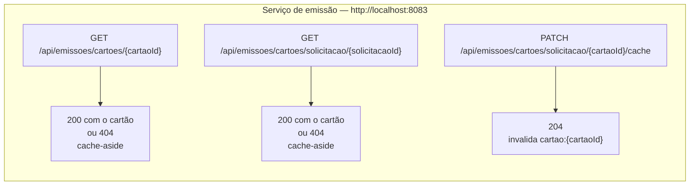
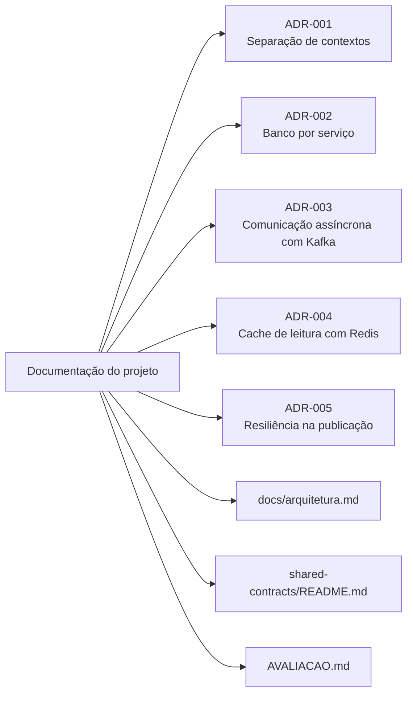

# Gerador de Cartão

Sistema de **contratação e emissão de cartões** organizado em dois microsserviços com contextos delimitados, bancos segregados, comunicação assíncrona por eventos e cache de leitura.

## 1. Tema

O domínio é o ciclo de vida de um cartão: o cliente solicita o cartão, a solicitação é registrada e o cartão é emitido de forma assíncrona. O projeto aplica os padrões do módulo — bounded contexts, banco por serviço, mensageria, idempotência, cache, resiliência e contratos executáveis — a um problema de negócio próprio.

## 2. Problema

O fluxo de contratação precisa atender pedidos de cartão sem acoplar os contextos de **Solicitação** e **Emissão**:

- o cliente envia um pedido e recebe uma resposta rápida, sem esperar a geração do cartão;
- a emissão precisa ocorrer mesmo se o serviço de solicitação estiver momentaneamente indisponível;
- eventos podem ser entregues mais de uma vez, então a emissão não pode gerar cartões duplicados;
- consultas de cartão são mais frequentes que alterações e precisam de baixa latência;
- os dois contextos não podem compartilhar banco nem consultar os dados um do outro diretamente.

A solução separa os contextos, usa o Kafka como única via de integração e mantém o PostgreSQL como fonte da verdade de cada serviço.

## 3. Visão de arquitetura



### 3.1 Serviços e responsabilidades



Dentro do Docker Compose os serviços usam `kafka:29092`, `redis:6379` e `postgres-*:5432`. As portas `9092`, `5433` e `6379` são para acesso do host/IDE.

### 3.2 Eventos e garantia de entrega



`cartao.solicitado` vai da solicitação para a emissão; `cartao.emitido` vai da emissão para a solicitação e para consumidores externos; `cartao.dlt` recebe as mensagens que falharam no consumo de ambos os serviços.

A garantia declarada é **at-least-once**: uma mensagem pode ser entregue mais de uma vez. Por isso os consumidores são idempotentes:

- a emissão verifica se já existe cartão para o `solicitacaoId` antes de criar outro;
- a solicitação só altera o status para `EMITIDA` se ela ainda estiver `ABERTA`;
- mensagens com falha vão para `cartao.dlt`, com replay manual.

Os contratos dos eventos ficam em [`shared-contracts/eventos.json`](shared-contracts/eventos.json) e são verificados por **Pact** nos dois sentidos. Os pacts versionados estão em [`shared-contracts/pacts`](shared-contracts/pacts).

### 3.3 Cache de leitura

O serviço de emissão usa **cache-aside** no Redis:



- **Chaves:** `cartao:{cartaoId}` e `cartao:solicitacao:{solicitacaoId}`.
- **TTL:** 20 segundos.
- **Invalidação:** `DEL cartao:{cartaoId}` ao alterar o status e via `PATCH /api/emissoes/cartoes/solicitacao/{cartaoId}/cache`.
- **Fallback:** se o Redis falhar, a leitura segue direto no PostgreSQL.
- **Fonte da verdade:** PostgreSQL; o Redis pode ser apagado a qualquer momento.

### 3.4 Resiliência

- publicação do `cartao.solicitado` com `acks=all`, idempotência do producer, retry com backoff/jitter, timeout e circuit breaker;
- falha na publicação retorna `503` e a solicitação não é confirmada ao cliente;
- consumo com política de dead letter para `cartao.dlt`;
- a resposta `202 Accepted` só é enviada após o ack do Kafka.

## 4. Perfil de execução e fallbacks

**Perfil declarado: A — Docker Compose.** Todos os componentes sobem em containers e a execução foi validada nesse perfil.



Fallbacks e ressalvas:

- **Sem Redis:** a API de consulta continua funcionando, lendo do PostgreSQL.
- **Sem Docker para testes:** `./mvnw clean verify` executa testes unitários e de contrato sem PostgreSQL, Kafka ou Redis.
- **Sem Docker para a aplicação completa:** é necessário ter PostgreSQL, Kafka e Redis locais e ajustar as URLs em `application.properties`; o projeto não inclui um modo totalmente in-memory para os dois serviços.

## 5. Como rodar

### 5.1 Pré-requisitos

- Docker com Docker Compose v2 (perfil A);
- Java 21 e Maven Wrapper (perfil B e testes).

### 5.2 Perfil A — Docker Compose

```bash
docker compose up -d --build
docker compose ps          # aguarde os containers ficarem healthy
```

O Kafka pode levar de 15 a 30 segundos para ficar `healthy`.

Acesse:

- Swagger da solicitação: <http://localhost:8081/q/swagger-ui>
- Swagger da emissão: <http://localhost:8083/q/swagger-ui>
- OpenAPI: <http://localhost:8081/q/openapi> e <http://localhost:8083/q/openapi>

Smoke test do fluxo:

```bash
# Cria a solicitação; resposta esperada: 202 Accepted + Location
curl -i -X POST http://localhost:8081/api/solicitacoes \
  -H 'Content-Type: application/json' \
  -d '{"clienteId":"111"}'

# Consulta a solicitação (o cartão é emitido de forma assíncrona)
curl http://localhost:8081/api/solicitacoes/1

# Consulta o cartão gerado para a solicitação
curl http://localhost:8083/api/emissoes/cartoes/solicitacao/1
```

Se o cartão ainda não aparecer, aguarde alguns segundos e consulte novamente; a emissão depende do consumo do evento.

Para acompanhar ou derrubar o ambiente:

```bash
docker compose logs -f servico-solicitacao servico-emissao kafka
docker compose down        # mantém os dados
docker compose down -v     # remove os volumes e apaga os dados
```

### 5.3 Perfil B — aplicações na JVM

Suba apenas a infraestrutura:

```bash
docker compose up -d postgres-solicitacao postgres-emissao redis kafka
```

Em dois terminais, rode cada serviço:

```bash
cd solicitacao && ./mvnw quarkus:dev
cd emissao && ./mvnw quarkus:dev
```

As configurações padrão já apontam para `localhost:5432`, `localhost:5433`, `localhost:9092` e `localhost:6379`. Para sobrescrever, use variáveis de ambiente ou `-D`, por exemplo:

```bash
QUARKUS_DATASOURCE_JDBC_URL=jdbc:postgresql://localhost:5432/solicitacao_cartao_db \
KAFKA_BOOTSTRAP_SERVERS=localhost:9092 \
./mvnw quarkus:dev
```

### 5.4 Perfil C — conceitual

Não há execução de aplicação neste perfil. A visão conceitual está em [`docs/arquitetura.md`](docs/arquitetura.md), os fluxos de negócio em [`projeto-final-contratacao-cartao.md`](projeto-final-contratacao-cartao.md) e as decisões em [`docs/adr`](docs/adr).

### 5.5 Testes automatizados

Cada serviço tem build Maven independente (não há `pom.xml` raiz multi-módulo):

```bash
cd solicitacao && ./mvnw clean verify
cd emissao && ./mvnw clean verify
```

Os comandos executam:

- testes unitários com JUnit 5 + Mockito;
- testes de contrato Pact de consumer e provider, nos dois sentidos;
- verificação de cobertura com JaCoCo, com mínimo de **80% de linhas**.

Não é necessário subir Docker, PostgreSQL, Kafka ou Redis para os testes. Os relatórios de cobertura ficam em `target/site/jacoco/index.html`.

## 6. Endpoints

### Serviço de solicitação (`http://localhost:8081`)



Exemplo de corpo do `POST`:

```json
{
  "clienteId": "111"
}
```

### Serviço de emissão (`http://localhost:8083`)



## 7. Estrutura do repositório

```
.
├── README.md
├── AVALIACAO.md                  # auto-avaliação por critério, com evidências
├── docker-compose.yml            # infra + serviços (perfil A)
├── docs/
│   ├── arquitetura.md            # contextos, fluxos, cache e contratos
│   └── adr/                      # ADR-001 a ADR-005
├── solicitacao/                  # microsserviço de Solicitação (Quarkus + Maven)
├── emissao/                      # microsserviço de Emissão (Quarkus + Maven)
├── shared-contracts/
│   ├── eventos.json              # contratos dos eventos
│   └── pacts/                    # pacts versionados
├── endpoints.yaml                # coleção de endpoints
└── endpoints-bruno.json          # coleção para o Bruno
```

## 8. Decisões e documentação



Os documentos estão em [`docs/adr`](docs/adr), [`docs/arquitetura.md`](docs/arquitetura.md), [`shared-contracts/README.md`](shared-contracts/README.md) e [`AVALIACAO.md`](AVALIACAO.md).
