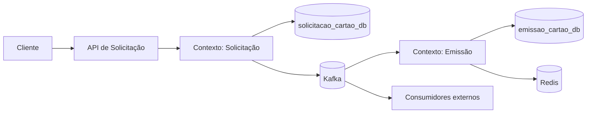
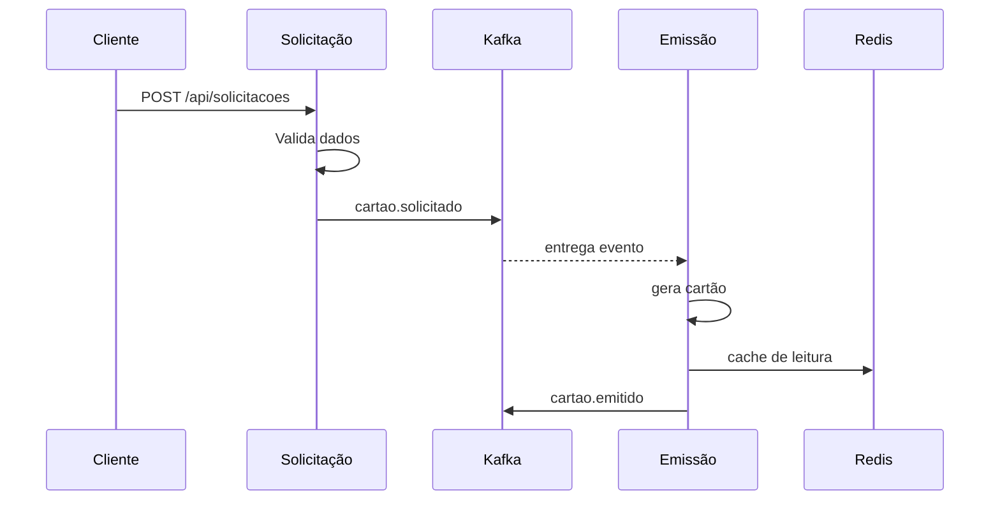

# Arquitetura do sistema

## Visão geral
O sistema de geração de cartão é composto por dois microsserviços com domínios distintos: solicitação e emissão. Cada serviço gerencia seu próprio banco de dados, regras de negócio e integrações.

## Contextos de negócio

### 1. Contexto de Solicitação
Responsável por:
- receber a solicitação do cliente;
- validar dados mínimos;
- persistir a solicitação;
- publicar evento de solicitação criada.

### 2. Contexto de Emissão
Responsável por:
- consumir a solicitação validada;
- gerar o número do cartão;
- registrar a emissão;
- publicar evento de cartão emitido.

## Diagrama de contexto

## Fluxo de eventos e filas

### Tópicos principais
- `cartao.solicitado` — publicado por `solicitacao` e consumido por `emissao`.
- `cartao.emitido` — publicado por `emissao` e consumido por outros sistemas interessados.
- `cartao.dlt` — fila de dead letter para falhas de processamento.

### Fluxo

## Padrões aplicados

- Banco por serviço
- API de domínio isolada
- Eventos como mecanismo de integração
- Cache leitura com TTL
- Idempotência no consumidor

## Regras de integração

- O serviço de solicitação não acessa o banco de emissão.
- O serviço de emissão não acessa o banco de solicitação.
- O Redis é somente um cache operacional.
- O Kafka é a única via de sincronização entre contextos.

## Observações de operação

- O consumidor deve ignorar eventos duplicados.
- O processamento deve ser tolerante a falhas e registrar eventos em DLQ quando necessário.
- A fonte da verdade continua sendo o banco do respectivo serviço.
