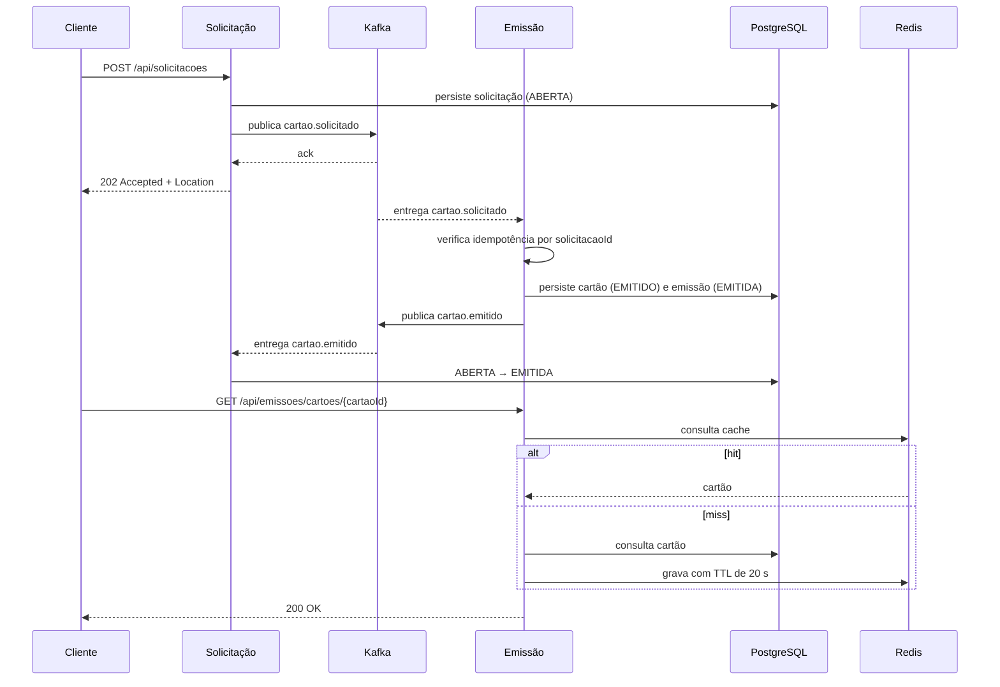

# Arquitetura do sistema

> Documento vivo: reflete o estado atual dos serviços, da infra local e das decisões registradas em `docs/adr`.

## 1. Visão geral

Dois microsserviços com contextos e bancos separados, integrados por eventos no Kafka e com cache de leitura no Redis.

| Serviço | Porta no host | Banco | Dependências |
|---|---|---|---|
| `servico-solicitacao` | 8081 | `solicitacao_cartao_db` (5432) | Kafka |
| `servico-emissao` | 8083 | `emissao_cartao_db` (5433) | Kafka, Redis |
| Kafka | 9092 | — | — |
| Redis | 6379 | — | — |

Dentro do Docker Compose, use os nomes dos serviços (`kafka:29092`, `redis:6379`, `postgres-*:5432`). As portas `5432`/`5433`, `6379` e `9092` são mapeadas para acesso do host/IDE.

## 2. Contextos e fluxo

```
POST /api/solicitacoes
          │  202 Accepted + Location  (status inicial: ABERTA)
          ▼
┌──────────────────────────────┐
│ servico-solicitacao   :8081  │  bounded context: SOLICITAÇÃO
│ PostgreSQL                   │  solicitacao_cartao_db
└──────────────┬───────────────┘
               │ publica cartao.solicitado
               │ (responde 202 somente após o ack)
               ▼
        ╔══════════════╗
        ║     Kafka    ║
        ╚══════════════╝
               │ entrega (at-least-once)
               ▼
┌──────────────────────────────┐
│ servico-emissao       :8083  │  bounded context: EMISSÃO
│ PostgreSQL + Redis           │  emissao_cartao_db
│ cartão gerado + cache 20 s   │
└──────────────┬───────────────┘
               │ publica cartao.emitido
               ▼
        ╔══════════════╗
        ║     Kafka    ║
        ╚══════════════╝
          ┌────┴─────┐
          ▼          ▼
   solicitação   consumidores
 ABERTA→EMITIDA   externos
```

- Falha no consumo de qualquer um dos serviços → `cartao.dlt` (replay manual).
- Redis indisponível → a leitura segue direto no PostgreSQL.
- `GET /api/emissoes/cartoes/{cartaoId}`: Redis (hit) → PostgreSQL (miss) → grava com TTL de 20 s.

## 3. Contextos de negócio

### 3.1 Contexto de Solicitação
- recebe `POST /api/solicitacoes` e valida o `clienteId`;
- persiste a solicitação com status `ABERTA`;
- publica `cartao.solicitado` e só então responde `202 Accepted` com `Location`;
- consome `cartao.emitido` e atualiza a solicitação para `EMITIDA`;
- expõe `GET /api/solicitacoes/{id}`.

### 3.2 Contexto de Emissão
- consome `cartao.solicitado`;
- verifica idempotência: se já existe cartão para o `solicitacaoId`, ignora o evento;
- gera o número do cartão e persiste `Cartao` (`EMITIDO`) e `Emissao` (`EMITIDA`);
- publica `cartao.emitido`;
- expõe consultas por ID e por `solicitacaoId`, com cache-aside no Redis;
- expõe `PATCH /api/emissoes/cartoes/solicitacao/{cartaoId}/cache` para invalidar a chave `cartao:{cartaoId}`.

### 3.3 Estados
| Entidade | Estado na criação | Transição implementada |
|---|---|---|
| Solicitação | `ABERTA` | `ABERTA → EMITIDA` ao consumir `cartao.emitido` |
| Cartão | `EMITIDO` | `ATIVO`, `BLOQUEADO` e `CANCELADO` previstos no enum, sem endpoint exposto |

## 4. Fluxo de eventos e tópicos

| Tópico | Producer | Consumer | Uso |
|---|---|---|---|
| `cartao.solicitado` | `solicitacao` | `emissao` | solicitar a emissão do cartão |
| `cartao.emitido` | `emissao` | `solicitacao` e consumidores externos | concluir a solicitação e notificar interessados |
| `cartao.dlt` | ambos (DLT) | operação manual | mensagens que falharam no processamento |



Cada serviço usa apenas o próprio banco; o diagrama mostra um único participante `PostgreSQL` por simplicidade.

## 5. Cache de leitura

| Item | Definição |
|---|---|
| Estratégia | cache-aside: a aplicação lê do Redis, busca no banco no miss e grava o resultado |
| Chaves | `cartao:{cartaoId}` e `cartao:solicitacao:{solicitacaoId}` |
| TTL | 20 segundos |
| Invalidação | `DEL cartao:{cartaoId}` ao alterar o status e via `PATCH .../cache` (idempotente, `204`) |
| Fonte da verdade | PostgreSQL; o Redis pode ser apagado a qualquer momento |
| Falha do Redis | a consulta segue no banco, sem indisponibilizar a API |

A invalidação explícita cobre a chave por ID; a chave por solicitação é corrigida pelo TTL curto de 20 s.

## 6. Padrões aplicados

| Padrão | Onde aparece | Referência |
|---|---|---|
| Contextos separados (DDD) | módulos `solicitacao/` e `emissao/` | ADR-001 |
| Banco por serviço | dois PostgreSQL no `docker-compose.yml` | ADR-002 |
| Eventos assíncronos | `cartao.solicitado` e `cartao.emitido` | ADR-003 |
| Idempotência no consumidor | verificação de cartão por `solicitacaoId` | ADR-003 / ADR-005 |
| Cache-aside com TTL | `CartaoService` + Redis | ADR-004 |
| Resiliência na publicação | ack, `acks=all`, retry, timeout e `503` | ADR-005 |
| Mensagens problemáticas | `failure-strategy=dead-letter-queue` | `application.properties` |
| Contratos compartilhados | `shared-contracts/eventos.json` | `shared-contracts/README.md` |

## 7. Contratos entre serviços

Os contratos ficam em `shared-contracts/eventos.json` e devem evoluir de forma compatível com os consumers.

**`cartao.solicitado`** (producer `solicitacao`, consumer `emissao`)
- `solicitacaoId`, `clienteId`, `dataSolicitacao`

**`cartao.emitido`** (producer `emissao`, consumers `solicitacao` e externos)
- `solicitacaoId`, `clienteId`, `cartaoId`, `numeroCartao`, `status`, `dataSolicitacao`, `ocorridoEm`

Os contratos são verificados por Pact nos dois sentidos. Os pacts ficam em `shared-contracts/pacts` e os testes de consumer/provider rodam no `mvn verify` de cada serviço, sem depender da infraestrutura.

## 8. Regras de integração

- O serviço de solicitação não acessa o banco de emissão.
- O serviço de emissão não acessa o banco de solicitação.
- O Kafka é a única via de sincronização entre os contextos.
- Os eventos são entregues pelo menos uma vez; os consumers devem ser idempotentes.
- O Redis é apenas cache operacional: a fonte da verdade é o PostgreSQL do respectivo serviço.
- Novos campos em eventos entram primeiro em `shared-contracts`, preservando compatibilidade.

## 9. Observações de operação

- O consumidor ignora eventos duplicados (cartão já existente ou solicitação fora de `ABERTA`).
- Mensagens que falham no consumo vão para `cartao.dlt`; o replay é manual.
- Os dois serviços compartilham o mesmo tópico de DLT: use os headers (`tópico`, `partição`, `offset`, exceção) para identificar a origem.
- A publicação do evento e o commit do banco não são atômicos: se o commit falhar após o envio, o evento pode ficar órfão.
- O TTL de 20 s limita o tempo máximo de leitura desatualizada.
- Logs em tempo real: `docker compose logs -f servico-solicitacao servico-emissao`.
- Saúde dos containers: `docker compose ps`.
