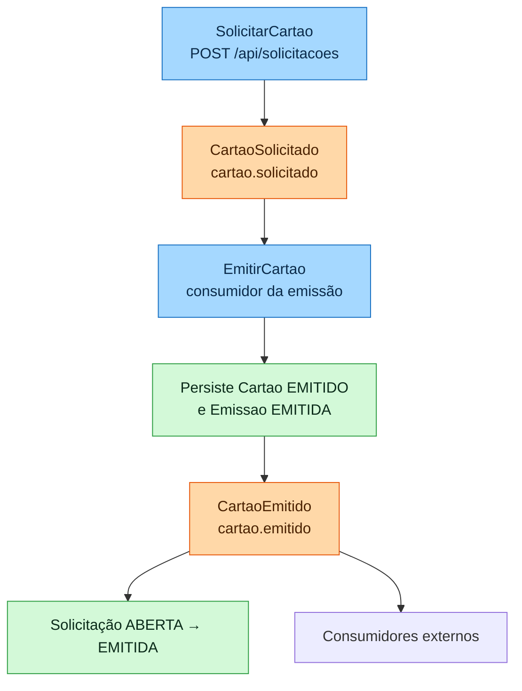
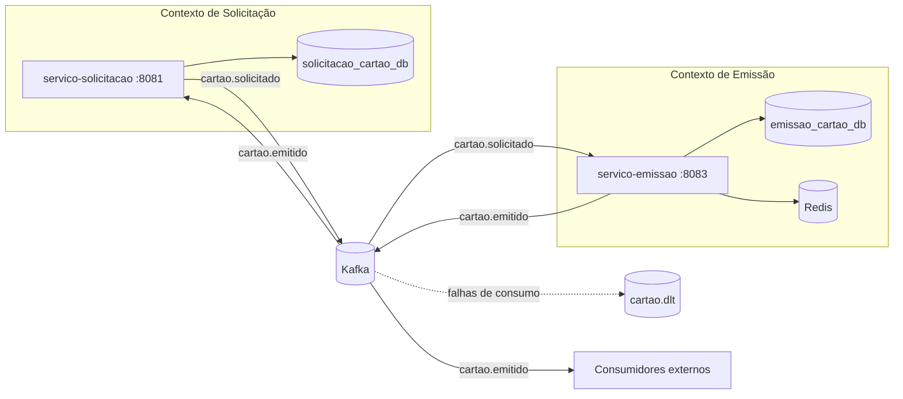
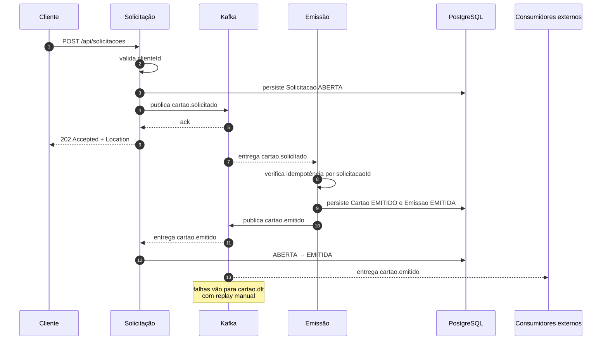
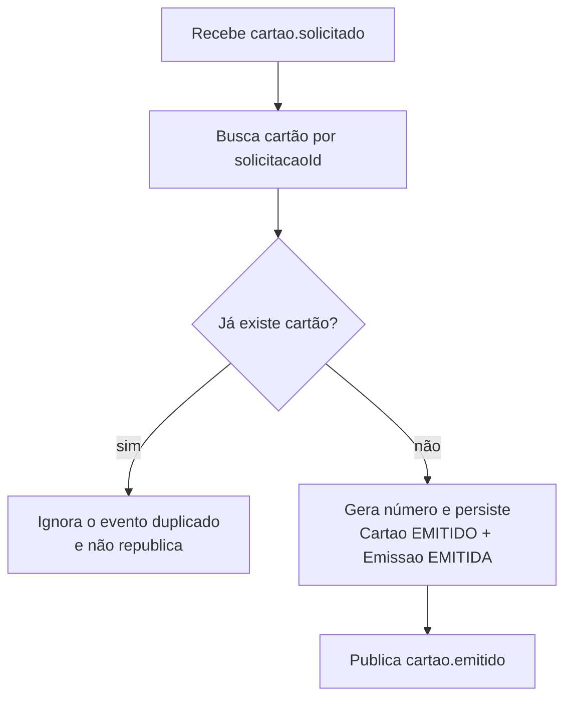
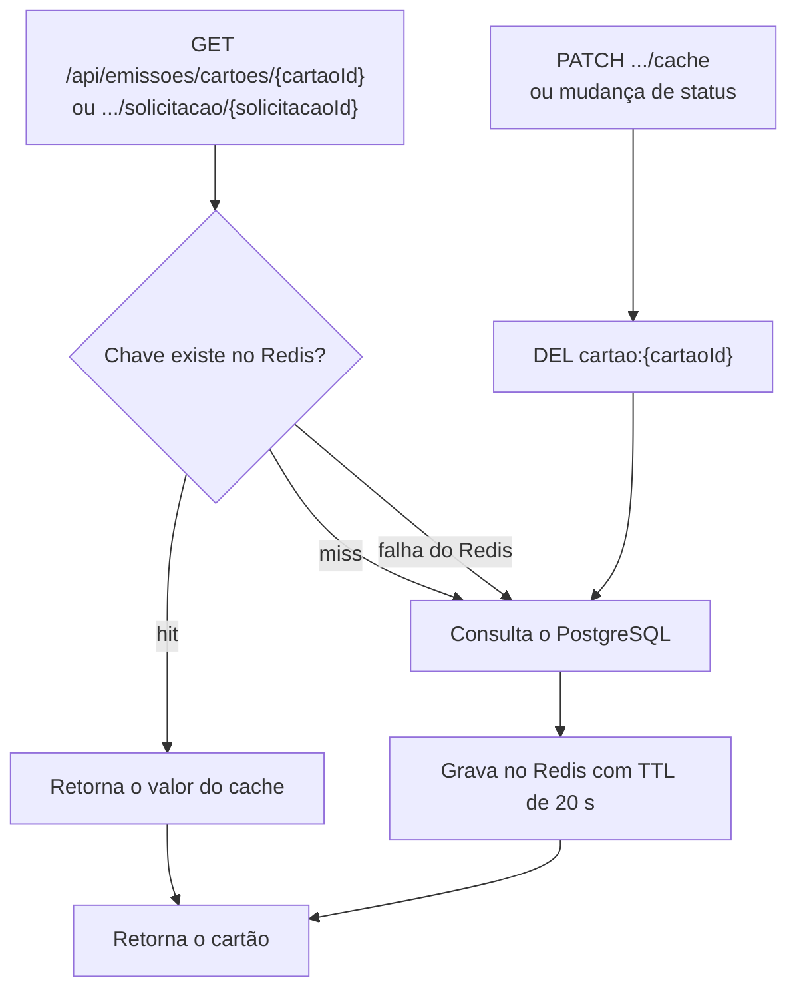

# Projeto Final: Contratação e Emissão de Cartão

> Documento de domínio alinhado à implementação atual. A visão técnica consolidada está em [`docs/arquitetura.md`](docs/arquitetura.md) e as instruções de execução em [`README.md`](README.md).

## 1. Visão geral

O projeto implementa dois microsserviços Quarkus com contextos de negócio separados, bancos PostgreSQL segregados, comunicação assíncrona pelo Kafka e cache de leitura no Redis.

| Serviço | Porta no host | Banco | Dependências |
|---|---:|---|---|
| `servico-solicitacao` | 8081 | `solicitacao_cartao_db` (5432) | Kafka |
| `servico-emissao` | 8083 | `emissao_cartao_db` (5433) | Kafka, Redis |

O fluxo é **assíncrono e orientado a eventos**: a solicitação responde `202 Accepted` após publicar `cartao.solicitado`, e a emissão acontece quando esse evento é consumido. Depois de emitir o cartão, o serviço de emissão publica `cartao.emitido`, que é consumido pela solicitação e por consumidores externos.

## 2. Fase 1 — Entendimento do domínio

### Evento de negócio principal

Um cliente solicita um cartão. O sistema registra a solicitação, publica `cartao.solicitado`, e o contexto de emissão gera o cartão. O resultado é comunicado por `cartao.emitido`, que fecha o ciclo atualizando a solicitação para `EMITIDA`.

### Fluxo principal implementado

1. O cliente chama `POST /api/solicitacoes` informando o `clienteId`.
2. O serviço de solicitação valida o `clienteId` (obrigatório, no máximo 64 caracteres) e persiste uma `Solicitacao` com status `ABERTA`.
3. O evento `cartao.solicitado` é publicado no Kafka. A resposta `202 Accepted + Location` só é enviada depois do ack do broker.
4. O serviço de emissão consome `cartao.solicitado`, verifica a idempotência por `solicitacaoId`, gera o número do cartão e persiste `Cartao` com status `EMITIDO` e `Emissao` com status `EMITIDA`.
5. O serviço de emissão publica `cartao.emitido`.
6. O serviço de solicitação consome `cartao.emitido` e altera a solicitação de `ABERTA` para `EMITIDA`; eventos duplicados são ignorados.
7. Consumidores externos também podem consumir `cartao.emitido`.
8. Consultas de cartão usam cache-aside no Redis, com fallback para o PostgreSQL.
9. Mensagens que falham no consumo vão para `cartao.dlt`, com replay manual.

### O que não faz parte do fluxo atual

- Não há evento `SolicitacaoValidada` nem transição para o status `VALIDADA`; a validação do `clienteId` ocorre no recebimento do `POST`.
- Não existe endpoint nem comando de cancelamento de solicitação.
- Não há SAGA, compensação ou outbox nesta versão.
- Não há endpoints para alterar o status do cartão para `ATIVO`, `BLOQUEADO` ou `CANCELADO`.

## 3. Fase 2 — Linguagem ubíqua

| Termo | Significado |
|---|---|
| Cliente | Identificado pelo `clienteId`; não há entidade `Cliente` persistida nesta versão. |
| Solicitação | Pedido de emissão de cartão, representado pela entidade `Solicitacao`. |
| Cartão | Produto emitido para o cliente, representado pela entidade `Cartao`. |
| Emissão | Processo e registro da geração do cartão, representado pela entidade `Emissao`. |
| Status | Situação atual da solicitação, do cartão ou da emissão. |
| `cartao.solicitado` | Evento publicado pela solicitação para pedir a emissão do cartão. |
| `cartao.emitido` | Evento publicado pela emissão após o cartão ser gerado. |
| Idempotência | Garantia de que o reprocessamento do mesmo evento não gera outro cartão para a mesma solicitação. |
| Cache-aside | Estratégia em que a aplicação consulta o Redis, busca no PostgreSQL no miss e grava o resultado no cache. |
| DLT | Dead letter topic `cartao.dlt`, usado para mensagens que falharam no consumo. |

### Status existentes

| Entidade | Valores do enum | Transições implementadas |
|---|---|---|
| `Solicitacao` | `ABERTA`, `VALIDADA`, `EMITIDA`, `CANCELADA` | `ABERTA → EMITIDA` ao consumir `cartao.emitido` |
| `Cartao` | `EMITIDO`, `ATIVO`, `BLOQUEADO`, `CANCELADO` | Criação em `EMITIDO`; os demais valores existem no enum, sem endpoint de transição |
| `Emissao` | `PENDENTE`, `VALIDADA`, `EMITIDA`, `ATIVA`, `CANCELADA` | Criação em `EMITIDA`; os demais valores não são usados no fluxo atual |

## 4. Fase 3 — Event Storming

### Comandos

| Comando | Situação na implementação |
|---|---|
| `SolicitarCartao` | Implementado por `POST /api/solicitacoes`. |
| `EmitirCartao` | Implementado pelo consumidor de `cartao.solicitado` no serviço de emissão. |
| `ValidarSolicitacao` | Existe apenas a validação do `clienteId` no `POST`; não há comando ou evento separado. |
| `CancelarSolicitacao` | Previsto no domínio, mas não implementado. |

### Eventos de domínio

| Evento | Tópico | Situação |
|---|---|---|
| `CartaoSolicitado` | `cartao.solicitado` | Publicado pela solicitação; consumido pela emissão. |
| `CartaoEmitido` | `cartao.emitido` | Publicado pela emissão; consumido pela solicitação e por consumidores externos. |
| `SolicitacaoValidada` | — | Não é publicado. O nome permanece em classes, DTOs e métodos históricos do consumidor da emissão, que consome `cartao.solicitado`. |
| `SolicitacaoCancelada` | — | Previsto no domínio, mas não implementado. |

### Regras de negócio

1. Toda solicitação deve ter um `clienteId` não vazio e com no máximo 64 caracteres.
2. A mesma solicitação não pode gerar mais de um cartão; além da verificação no consumidor, `cartao.solicitacao_id` e `emissao.solicitacao_id` são únicos no banco.
3. A emissão só ocorre depois que o serviço de emissão consome `cartao.solicitado`, publicado somente após a validação do `clienteId` e a persistência da solicitação.
4. Eventos repetidos devem ser ignorados: a emissão não cria outro cartão e a solicitação só muda para `EMITIDA` se ainda estiver `ABERTA`.
5. A entrega é **at-least-once**, portanto os consumidores precisam ser idempotentes.
6. A regra de não emitir cartão para solicitação cancelada não está implementada, pois o cancelamento ainda não existe no fluxo.

### Fluxo simplificado



## 5. Fase 4 — Identificação dos bounded contexts

A divisão cria dois contextos de negócio separados e dois microsserviços com bancos de dados segregados.

### 5.1 Contexto de Solicitação

**Responsabilidades:**

- receber o pedido de cartão;
- validar o `clienteId` recebido;
- registrar a solicitação com status `ABERTA`;
- publicar `cartao.solicitado` e responder `202 Accepted` após o ack;
- consumir `cartao.emitido` e atualizar a solicitação para `EMITIDA`;
- expor a consulta por ID.

**Entidade principal:** `Solicitacao`. O `clienteId` é um atributo da solicitação; não existe entidade `Cliente` nesta versão.

**Banco de dados:**

```text
solicitacao_cartao_db
```

**Status:** `ABERTA` na criação; transição implementada para `EMITIDA`. `VALIDADA` e `CANCELADA` existem no enum, mas não são usados pelo fluxo atual.

### 5.2 Contexto de Emissão de Cartão

**Responsabilidades:**

- consumir o evento `cartao.solicitado`;
- verificar a idempotência pelo `solicitacaoId`;
- gerar o número do cartão;
- persistir `Cartao` com status `EMITIDO` e `Emissao` com status `EMITIDA`;
- publicar `cartao.emitido`;
- expor consultas por ID do cartão e por ID da solicitação, com cache-aside;
- invalidar o cache do cartão por ID.

**Entidades principais:** `Cartao` e `Emissao`.

**Banco de dados:**

```text
emissao_cartao_db
```

**Status:** o cartão é criado como `EMITIDO`; `ATIVO`, `BLOQUEADO` e `CANCELADO` estão previstos no enum, mas não há endpoint para essas transições. A emissão é criada como `EMITIDA`.

> Observação: a classe `SolicitacaoValidadaConsumer` e o DTO `SolicitacaoValidadaMessage` mantêm o nome histórico, mas o tópico consumido é `cartao.solicitado`. Não existe evento `SolicitacaoValidada` publicado.

### 5.3 Mapa de contextos — coreografia

A comunicação é descentralizada: cada contexto reage aos eventos sem um controlador central.



## 6. Fase 5 — Comunicação assíncrona

A comunicação entre os contextos é feita por mensageria no Kafka, com produtores e consumidores nos dois sentidos.

### 6.1 Produtor

- **Serviço:** `servico-solicitacao`
- **Tópico:** `cartao.solicitado`

O produtor usa `acks=all`, idempotência do producer, timeout e retry com backoff/jitter. A publicação aguarda o ack antes de responder ao cliente. Se a publicação falhar, a API retorna `503` e a transação da solicitação é desfeita.

Exemplo de evento:

```json
{
  "solicitacaoId": 999,
  "clienteId": "111",
  "dataSolicitacao": "2026-10-09T18:00:00Z"
}
```

O `solicitacaoId` é numérico e `dataSolicitacao` é um `Instant` serializado em UTC.

### 6.2 Consumidor

- **Serviço:** `servico-emissao`
- **Consome:** `cartao.solicitado`
- **Processa:** verificação de idempotência, geração do cartão e persistência de `Cartao` + `Emissao`
- **Publica:** `cartao.emitido`

A classe de consumo é `SolicitacaoValidadaConsumer`, mas o tópico configurado é `cartao.solicitado`. Mensagens inválidas ou falhas de processamento são encaminhadas para `cartao.dlt`.

### 6.3 Evento `cartao.emitido`

O evento publicado pela emissão contém:

```json
{
  "solicitacaoId": "999",
  "clienteId": "111",
  "cartaoId": "5001",
  "numeroCartao": "1000000000000001",
  "status": "EMITIDO",
  "dataSolicitacao": "2026-10-09T18:00:00Z",
  "ocorridoEm": "2026-10-09T18:00:02Z"
}
```

O `solicitacaoId` e o `cartaoId` são representados como strings nesse evento. O contrato canônico está em [`shared-contracts/eventos.json`](shared-contracts/eventos.json).

### 6.4 Fluxo completo



### 6.5 Garantia de entrega e resiliência

- A garantia declarada é **at-least-once**.
- O consumidor de `cartao.emitido` só atualiza solicitações em `ABERTA`; os demais casos são ignorados.
- O consumidor de `cartao.solicitado` não cria um segundo cartão para o mesmo `solicitacaoId`.
- Falhas de publicação no produtor retornam `503`.
- Falhas de consumo são encaminhadas para `cartao.dlt`; o replay é manual.
- A publicação no Kafka e o commit no banco não são atômicos; não há outbox nesta versão.

## 7. Fase 6 — Idempotência

O consumidor de `cartao.solicitado` é idempotente. A chave de idempotência é o `solicitacaoId`.

### Mecanismo implementado

1. O consumidor consulta `CartaoRepository.buscarPorSolicitacaoId`.
2. Se já existe cartão para a solicitação, o evento é ignorado e a emissão existente é retornada sem republicar `cartao.emitido`.
3. Se não existe, o cartão e a emissão são persistidos na mesma transação.
4. O banco reforça a regra com restrições `unique` em `cartao.solicitacao_id` e `emissao.solicitacao_id`.

Não há tabela `eventos_processados` nesta versão; a própria unicidade do cartão por `solicitacaoId` funciona como mecanismo de idempotência.



No consumidor de `cartao.emitido`, a idempotência é feita pela transição de estado: somente solicitações com status `ABERTA` são atualizadas para `EMITIDA`.

## 8. Fase 7 — Cache-aside

O cache é aplicado nas consultas de cartão, pois a leitura tende a ser mais frequente que a alteração.

### Endpoints implementados

| Método | Caminho | Comportamento |
|---|---|---|
| `GET` | `/api/emissoes/cartoes/{cartaoId}` | Consulta por ID do cartão; usa cache-aside. |
| `GET` | `/api/emissoes/cartoes/solicitacao/{solicitacaoId}` | Consulta pelo ID da solicitação; usa cache-aside. |
| `PATCH` | `/api/emissoes/cartoes/solicitacao/{cartaoId}/cache` | Invalida a chave `cartao:{cartaoId}`; retorna `204`. |

### Estratégia

- **Chaves:** `cartao:{cartaoId}` e `cartao:solicitacao:{solicitacaoId}`.
- **TTL:** 20 segundos.
- **Invalidação:** `DEL cartao:{cartaoId}` ao alterar o status e via `PATCH .../cache`. A chave por solicitação é corrigida pelo TTL curto de 20 segundos.
- **Fallback:** se o Redis falhar, a leitura segue direto no PostgreSQL.
- **Fonte da verdade:** o PostgreSQL; o Redis pode ser apagado a qualquer momento.
- **Uso:** acelerar consultas repetidas sem tornar o Redis obrigatório para a disponibilidade da API.

### Fluxo da consulta



## 9. API implementada

| Serviço | Método | Caminho | Resposta e comportamento |
|---|---|---|---|
| Solicitação | `POST` | `/api/solicitacoes` | `202 Accepted + Location`; `400` para dados inválidos e `503` em falha de publicação; valida `clienteId`, persiste `ABERTA` e publica `cartao.solicitado` |
| Solicitação | `GET` | `/api/solicitacoes/{id}` | `200` com a solicitação; `400` para ID inválido; `404` se não encontrada |
| Emissão | `GET` | `/api/emissoes/cartoes/{cartaoId}` | `200` com o cartão; `404` se não encontrado; cache-aside |
| Emissão | `GET` | `/api/emissoes/cartoes/solicitacao/{solicitacaoId}` | `200` com o cartão; `404` se não encontrado; cache-aside |
| Emissão | `PATCH` | `/api/emissoes/cartoes/solicitacao/{cartaoId}/cache` | `204`; invalida `cartao:{cartaoId}` de forma idempotente |

## 10. Contratos, testes e operação

- Os contratos dos eventos estão em [`shared-contracts/eventos.json`](shared-contracts/eventos.json).
- Os contratos são verificados por Pact nos dois sentidos: a emissão verifica o consumo de `cartao.solicitado` e a solicitação verifica o consumo de `cartao.emitido`. Cada serviço também verifica o evento que publica.
- Os pacts gerados ficam em [`shared-contracts/pacts`](shared-contracts/pacts).
- Os testes rodam sem Docker, PostgreSQL, Kafka ou Redis:

```bash
cd solicitacao && ./mvnw clean verify
cd emissao && ./mvnw clean verify
```

- O build exige cobertura mínima de 80% de linhas em cada serviço.
- A execução completa do sistema está documentada no [`README.md`](README.md), com o perfil A (Docker Compose) e o fallback B (infraestrutura em Docker + aplicações na JVM).

## 11. Limitações e itens não implementados

- Não há comando, endpoint ou evento de cancelamento de solicitação.
- Não há evento `SolicitacaoValidada` nem transição para o status `VALIDADA`; o nome permanece em classes, DTOs e métodos históricos do consumidor da emissão.
- Não há SAGA nem compensação; o fluxo tem duas etapas e a consistência é eventual.
- Não há outbox: a publicação no Kafka e o commit no banco não são atômicos.
- Não há endpoints para alterar o status do cartão para `ATIVO`, `BLOQUEADO` ou `CANCELADO`.
- Não há testes de integração/e2e com a infraestrutura real; a cobertura automatizada é unitária e de contrato.
- O replay de mensagens da DLT é manual.

## 12. Referências

- [`README.md`](README.md) — tema, problema, arquitetura, execução e endpoints.
- [`docs/arquitetura.md`](docs/arquitetura.md) — visão técnica consolidada.
- [`docs/adr`](docs/adr) — decisões arquiteturais (ADR-001 a ADR-005).
- [`shared-contracts/README.md`](shared-contracts/README.md) — contratos e Pact.
- [`AVALIACAO.md`](AVALIACAO.md) — auto-avaliação e evidências.
