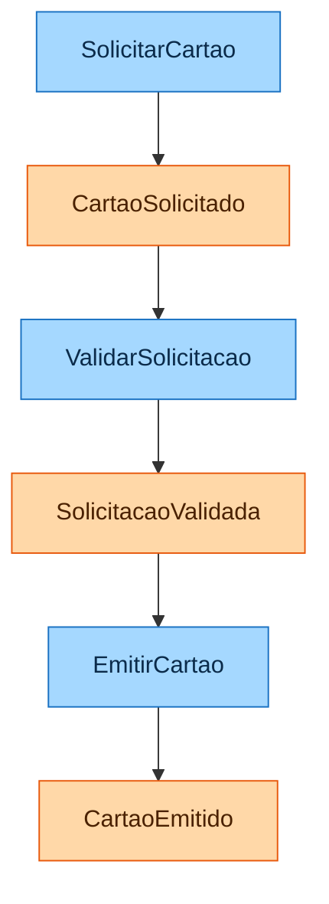
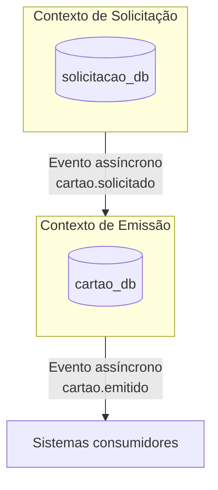
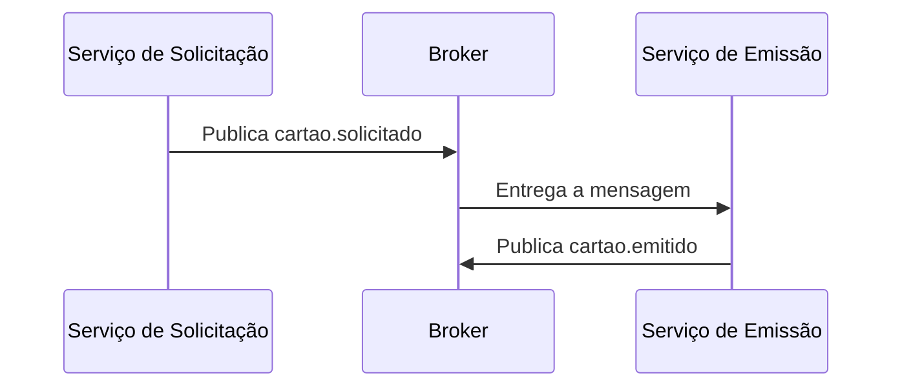
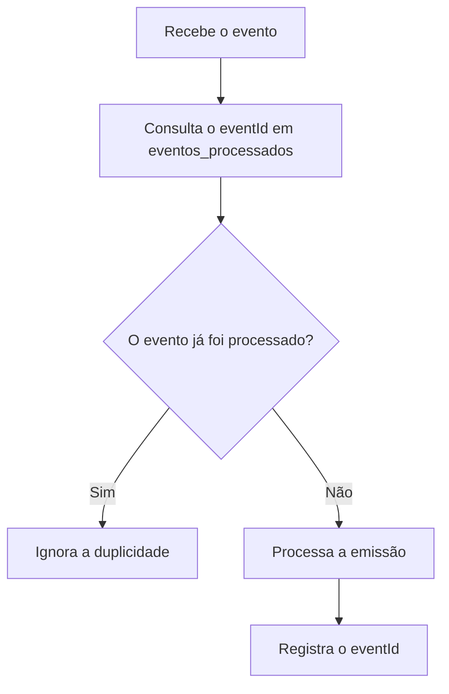
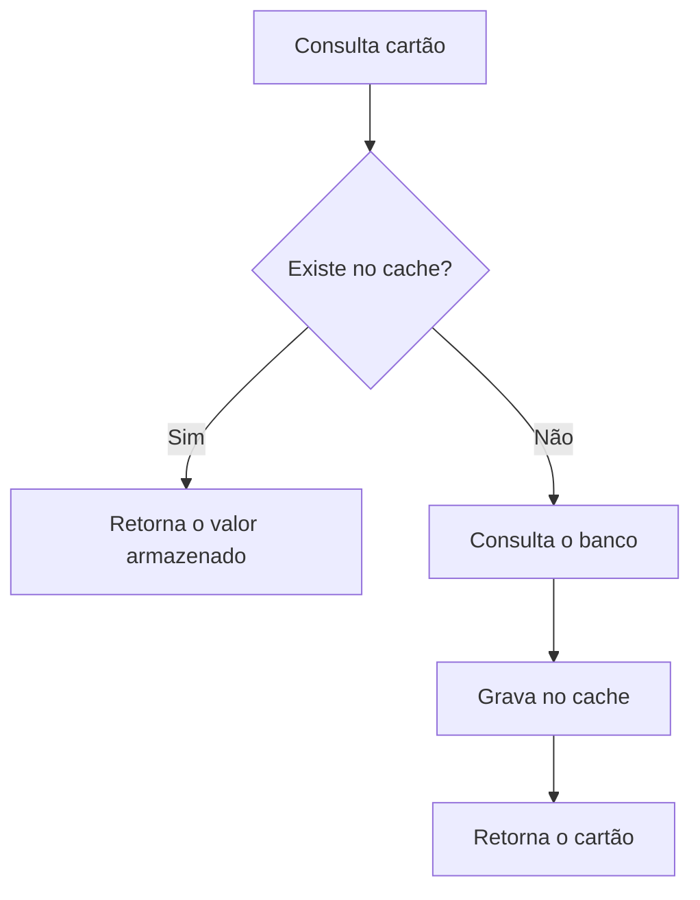

# Projeto Final: Contratação e Emissão de Cartão

## 1. Visão geral

## Fase 1: Entendimento do domínio

### Evento de negócio principal

Um cliente solicita um cartão, e o sistema cria uma solicitação de emissão que será processada até a geração do cartão.

### Fluxo principal

1. O cliente solicita um cartão.
2. A solicitação é registrada.
3. Os dados da solicitação são validados.
4. O cartão é gerado.
5. O cartão recebe um número e um status.
6. O evento de cartão emitido é publicado.
7. Outros sistemas interessados podem consumir o evento.

---

## Fase 2: Linguagem ubíqua

| Termo | Significado |
|---|---|
| Cliente | Pessoa que solicita o cartão. |
| Solicitação | Pedido de emissão de um cartão. |
| Proposta | Registro que inicia o processo de contratação e emissão. |
| Cartão | Produto emitido para o cliente. |
| Emissão | Processo de geração do cartão. |
| Status | Situação atual da solicitação ou do cartão. |
| Evento de Cartão Emitido | Mensagem publicada após a emissão do cartão. |

---

## Fase 3: Event Storming

### Comandos

- `SolicitarCartao`
- `ValidarSolicitacao`
- `EmitirCartao`
- `CancelarSolicitacao`

### Eventos de domínio

- `CartaoSolicitado`
- `SolicitacaoValidada`
- `CartaoEmitido`
- `SolicitacaoCancelada`

### Regras de negócio

1. Não é permitido emitir cartão para uma solicitação cancelada.
2. Uma mesma solicitação não pode gerar o cartão mais de uma vez.
3. Toda solicitação deve estar vinculada a um cliente.
4. A emissão somente pode ocorrer após a validação da solicitação.

### Fluxo simplificado



---

## Fase 4: Identificação dos bounded contexts 

A divisão abaixo cria dois contextos de negócio separados e permite a implementação de, no mínimo, dois microsserviços com bancos de dados segregados.

### 4.1. Contexto de Solicitação

**Responsabilidades:**

- receber o pedido de cartão;
- registrar a solicitação;
- validar as informações recebidas;
- controlar o status da solicitação;
- publicar o evento de solicitação validada.

**Entidades principais:**

- `Solicitacao`
- `Cliente`

**Banco de dados:**

```text
solicitacao_db
```

### 4.2. Contexto de Emissão de Cartão

**Responsabilidades:**

- consumir a mensagem de solicitação validada;
- gerar o cartão;
- controlar o ciclo de emissão;
- definir número e status do cartão;
- publicar o evento de cartão emitido.

**Entidades principais:**

- `Cartao`
- `Emissao`

**Banco de dados:**

```text
cartao_db
```

### 4.3. Mapa de contextos - Coreografia



---

## 6. Fase 5: Comunicação assíncrona

A comunicação entre os contextos será feita por mensageria, com um produtor e um consumidor.

### 6.1. Produtor

**Serviço:** Serviço de Solicitação  
**Tópico:** `cartao.solicitado`

Exemplo de evento:

```json
{
  "eventId": "123",
  "solicitacaoId": "999",
  "clienteId": "111",
  "dataSolicitacao": "2026-10-09T15:00:00-03:00"
}
```

### 6.2. Consumidor

**Serviço:** Serviço de Emissão  
**Consome:** `cartao.solicitado`  
**Processa:** emissão do cartão  
**Publica:** `cartao.emitido`

### Fluxo



---

## Fase 6: Idempotência

O consumidor deve ser idempotente, ou seja, o recebimento repetido do mesmo evento não pode provocar a emissão duplicada de um cartão.

### Chave de idempotência

```text
eventId
```

### Tabela sugerida

```text
eventos_processados
```

### Fluxo de processamento



---

## Fase 7: Cache - aside 

O cache pode ser aplicado na consulta de cartão, pois a leitura tende a ser mais frequente que a alteração.

### Endpoint sugerido

```http
GET /cartoes/{id}
```

### Estratégia

- **Chave:** identificador do cartão;
- **TTL:** 5 minutos;
- **Invalidação:** remover a entrada quando o status ou outro dado do cartão for alterado;
- **Uso:** acelerar consultas repetidas;
- **Fonte oficial:** o banco de dados continua sendo a fonte de verdade.

### Fluxo da consulta


